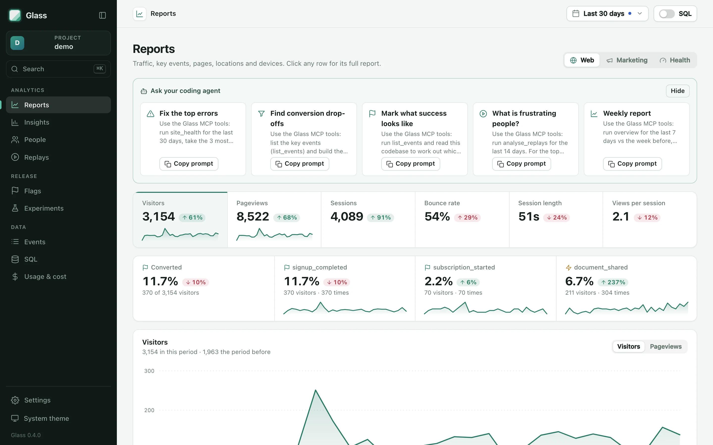
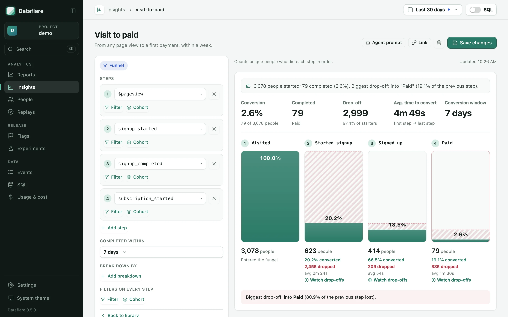
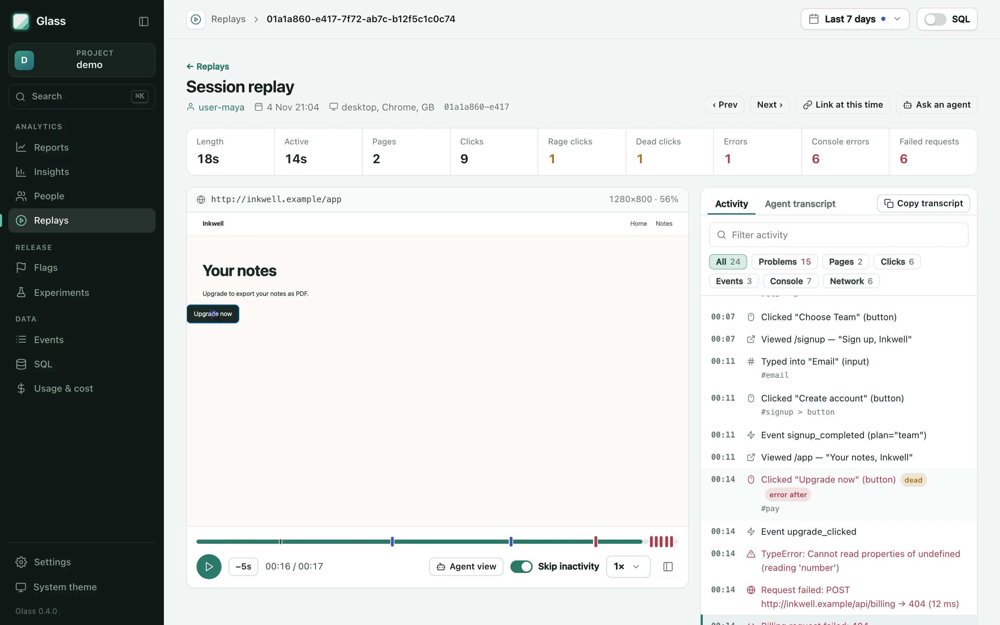
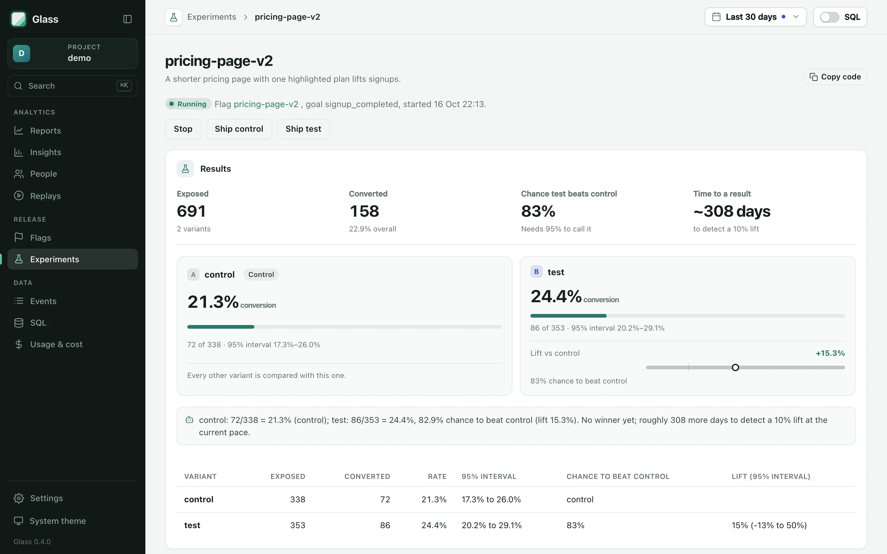
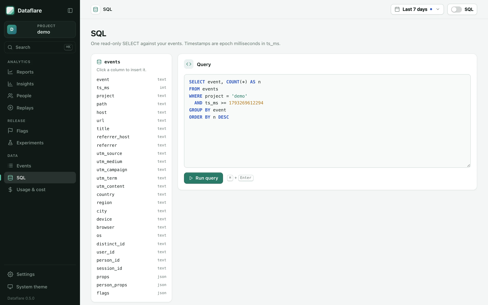

<h1 align="center">Dataflare</h1>

<p align="center"><strong>Open-source product analytics that lives in your Cloudflare account.</strong><br>
Web analytics, funnels and retention, session replay, feature flags and A/B tests. Deployed with one command, queried by your coding agent. Your data never leaves your account.</p>

<p align="center">
  <a href="https://www.npmjs.com/package/dataflare"></a>
  <a href="https://github.com/ISNIT0/glass-analytics/actions/workflows/ci.yml"></a>
  <a href="LICENSE"></a>
</p>

<p align="center">
  <a href="https://dataflare.dev/demo/"><strong>Live demo</strong></a> ·
  <a href="https://dataflare.dev/docs/">Docs</a> ·
  <a href="https://dataflare.dev/pricing/">Cost calculator</a> ·
  <a href="https://dataflare.dev/vs/">Comparisons</a>
</p>

<picture>
  <source media="(prefers-color-scheme: dark)" srcset="site/public/img/web-dark.webp">
  
</picture>

```sh
npx dataflare-cli init
```

Or paste this into your coding agent:

> Add Dataflare analytics to this project: run `npx dataflare-cli init`, track signups and purchases, then show me today's visitors.

## Why Dataflare

- **No vendor.** Dataflare is a Worker, a D1 database and an R2 bucket in _your_ Cloudflare account. There is no Dataflare server, account or bill: you pay Cloudflare's list prices, which is $0 on Workers Free for small sites and the $5/month Workers Paid plan for most others ([calculator](https://dataflare.dev/pricing/)).
- **Built for agents.** `dataflare init` writes instructions, a skill and an MCP server config for your agent. Every query result carries its SQL and a dashboard link, and session replays come with a text transcript an agent can read.
- **Four tools, one event stream.** Web stats, funnels/retention/trends on any property, session replay, and flags with Bayesian A/B testing. A funnel step links to the replays of the people who dropped out.
- **Small and readable.** The browser SDK is about 4 KB gzipped. The Worker has one runtime dependency (zod). Every number in the dashboard can show the SQL behind it.

<table>
  <tr>
    <td width="50%"><p align="center"><strong>Funnels, trends and retention</strong> on any event</p></td>
    <td width="50%"><p align="center"><strong>Session replay</strong> with a transcript agents can read</p></td>
  </tr>
  <tr>
    <td width="50%"><p align="center"><strong>Flags and A/B tests</strong> with Bayesian results</p></td>
    <td width="50%"><p align="center"><strong>Read-only SQL</strong> behind every number</p></td>
  </tr>
</table>

## How it compares

|                       | Dataflare                   | PostHog                           | Google Analytics | Plausible                             |
| --------------------- | --------------------------- | --------------------------------- | ---------------- | ------------------------------------- |
| Where your data lives | Your Cloudflare account     | PostHog Cloud, or your servers    | Google           | Plausible Cloud (EU), or your servers |
| Source                | MIT                         | MIT (some paid features separate) | Proprietary      | AGPL-3.0                              |
| Session replay        | Yes, with agent transcripts | Yes                               | No               | No                                    |
| Flags and A/B tests   | Yes                         | Yes                               | No               | No                                    |
| Raw SQL               | Yes                         | Yes                               | BigQuery export  | No                                    |

Each comparison on the site says where the other product is the better choice: [PostHog](https://dataflare.dev/vs/posthog/), [Google Analytics](https://dataflare.dev/vs/google-analytics/), [Plausible](https://dataflare.dev/vs/plausible/), [Amplitude](https://dataflare.dev/vs/amplitude/), [Mixpanel](https://dataflare.dev/vs/mixpanel/), [Umami](https://dataflare.dev/vs/umami/), [Cloudflare Web Analytics](https://dataflare.dev/vs/cloudflare-web-analytics/).

## Quick start

1. **Create a Cloudflare API token** at [dash.cloudflare.com/profile/api-tokens](https://dash.cloudflare.com/profile/api-tokens) with _Workers Scripts: Edit_, _D1: Edit_, _Workers R2 Storage: Edit_ and _Account Settings: Read_.
2. **Deploy** from your project directory:

   ```sh
   CLOUDFLARE_API_TOKEN=… npx dataflare-cli init
   ```

   This creates the database, the replay bucket and the Worker, then prints the snippet for your framework.
3. **Add the snippet** to every page:

   ```html
   <script defer src="https://glass.<you>.workers.dev/s.js" data-project="my-app"></script>
   ```
4. **Track what matters:**

   ```js
   glass.capture('signup_completed', { plan: 'pro' });
   glass.identify(user.id, { plan: user.plan }); // after login
   ```
5. **Ask.** Open `https://glass.<you>.workers.dev/app` (sign in with `npx dataflare-cli key`), or ask your agent: _"Which traffic source converts best to signup?"_

Run `npx dataflare-cli status` any time to check everything end to end. See [docs/getting-started.md](docs/getting-started.md) for frameworks, custom domains and EU data residency.

## What you get

|                           |                                                                                                                                                                                                                                                                                                                                                                             |
| ------------------------- | --------------------------------------------------------------------------------------------------------------------------------------------------------------------------------------------------------------------------------------------------------------------------------------------------------------------------------------------------------------------------- |
| **Web analytics**         | Visitors, pageviews, sessions, bounce rate, top/entry/exit pages, referrers, UTMs, countries, devices, errors, Core Web Vitals. Cookieless mode available.                                                                                                                                                                                                                  |
| **Product analytics**     | Trends, funnels and retention on any event, with filters and breakdowns on any event or person property. Read-only SQL for everything else.                                                                                                                                                                                                                                 |
| **People**                | `identify()` links anonymous visits to users, so funnels span the moment of signup. Person properties are snapshotted on every event.                                                                                                                                                                                                                                       |
| **Session replay**        | rrweb recording with inputs masked, sampling and "record when an error happens", plus console messages and network requests. A player with a timeline of clicks, errors and notes; search by what went wrong; patterns across sessions. Each session has a transcript agents read: pages, clicks with selectors, rage and dead clicks, errors with stacks, failed requests. |
| **Flags and experiments** | Flags evaluated server-side in your Worker, with targeting rules. Experiments report exposures, conversion, Bayesian probability to beat control, lift intervals and sample-ratio mismatch.                                                                                                                                                                                 |
| **Agent interface**       | An MCP server with 41 tools, a CLI with `--json` everywhere, an HTTP API, and `llms.txt`.                                                                                                                                                                                                                                                                                   |

## How it works

```
browser ──/s.js, /e, /r, /f──▶  Dataflare Worker  ──▶  D1 (events, people, flags, experiments, replay index)
agents  ──/mcp, /api───────▶  (your account) ──▶  R2 (replay chunks)
you     ──/app─────────────▶                  ──▶  optional: Pipelines → Iceberg on R2 → Basin SQL
```

Every query (web, trends, funnels, retention, experiments) compiles to SQL that runs on both D1 (SQLite) and Basin SQL, so you can start on the free plan and move high-volume event storage to the lake with `dataflare init --lake`. More in [docs/architecture.md](docs/architecture.md).

## Documentation

- [Getting started](docs/getting-started.md): install, frameworks, custom domain, EU, upgrading
- [Browser SDK](docs/sdk.md): `init`, `capture`, `identify`, flags, replay, consent
- [Agents](docs/agents.md): MCP tools, CLI, HTTP API
- [Queries](docs/queries.md): properties, filters, time ranges, every query type, SQL
- [Experiments](docs/experiments.md): flags, assignment and the statistics
- [Privacy](docs/privacy.md): what's stored, cookieless mode, deletion
- [Architecture](docs/architecture.md) and [the lake store](docs/lake.md)
- [Extending Dataflare](docs/extending.md): add a query type, MCP tool, storage engine or framework

## Status

Dataflare is new. The D1 store, SDK, dashboard, MCP server and CLI are covered by unit, integration and browser end-to-end tests. Two parts depend on Cloudflare products in beta and are marked **beta**: the lake store (Pipelines + Basin SQL) and anything that relies on their response formats. See [ROADMAP.md](ROADMAP.md).

## Contributing

Contributions are welcome. [CONTRIBUTING.md](CONTRIBUTING.md) explains the layout, how to run everything locally without a Cloudflare account (`pnpm dev`), and where to add things. Coding agents should read [AGENTS.md](AGENTS.md).

## License

[MIT](LICENSE)
